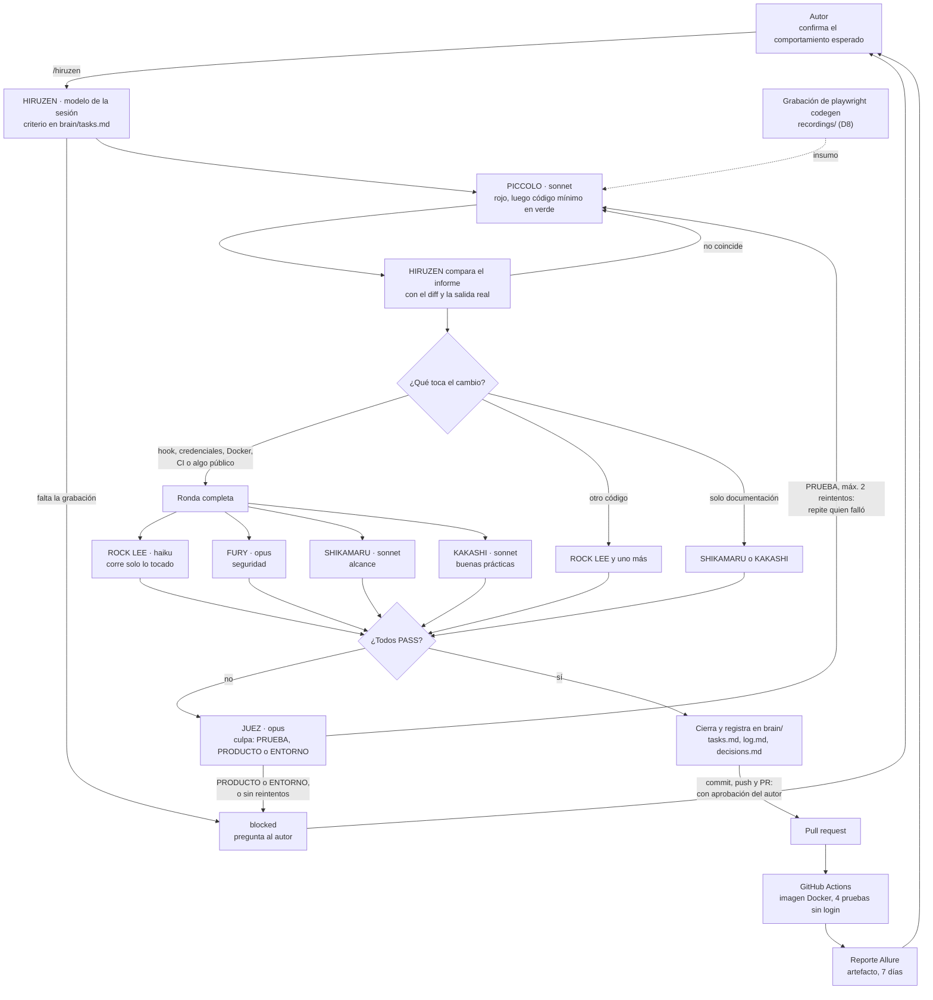
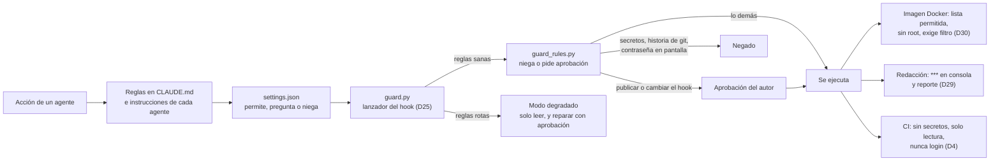

# Cómo construí esta suite con IA

Cómo trabajé, no solo qué entregué: qué decidí yo, el flujo de agentes que diseñé, sus reglas, sus barreras de seguridad y doce problemas reales. Todo se puede rastrear en [`brain/log.md`](../brain/log.md) (bitácora), [`brain/decisions.md`](../brain/decisions.md) (decisiones D-n con su porqué), [`brain/tasks.md`](../brain/tasks.md) (tareas y criterios) y [`.claude/`](../.claude/) (agentes, orquestador y hook).

## Mi rol

La IA implementa, propone y revisa. Yo decido qué se construye, detecto cuándo algo no es lo que quería y, cuando un error se puede repetir, lo convierto en regla.

- **La arquitectura de agentes.** Es la propuesta con la que vengo trabajando en mi experiencia laboral, construida a partir de estudiar distintos diseños de agentes. Aquí la implementé y sigue en evolución: faltan los evals (pruebas que miden qué tan bien hace su trabajo cada agente, con casos y resultados esperados), convertir partes del flujo en skills (instrucciones reutilizables que un agente carga para una tarea) y evaluarlos de forma cíclica para mejorarlos (ver [Próximos pasos](#próximos-pasos)).
- **Dónde probar.** La idea inicial era un ecommerce real. Lo descarté como sitio principal porque probar ahí era un riesgo: el tráfico de las pruebas podía afectar sus métricas. Elegí Toolshop, un sitio hecho para practicar, donde se puede llegar hasta el pago con tarjetas de prueba ([D14](../brain/decisions.md)).
- **Banderas en los datos.** Fue idea mía poner columnas `acceso` y `etapa` en los Ejemplos para que un mismo escenario produzca comportamientos distintos según la fila (caso 8).
- **Ver lo que los validadores aprobaron.** La captura de la home sin sesión (caso 7), T14, que cumplía el criterio pero no era lo que pedí (caso 4), y una ventana que se abría y cerraba varias veces.
- **Elegir entre opciones.** Direcciones reales con validación del autocompletado en vez de las que inventa la API ([D19](../brain/decisions.md)); cerrar T8 en verde y pasar sus observaciones a un refactor aparte (T10); captura en fallos y reporte HTML, sin trace ni video por ahora ([D29](../brain/decisions.md)).
- **Reglas al proceso.** Publicar siempre con mi aprobación (caso 3), validar solo la prueba tocada y confirmar el pedido antes de escribir el criterio (caso 4), no forzar fallos con la cuenta compartida (caso 6).
- **Definir cada tarea nueva.** Antes de escribir el criterio respondo las preguntas que bloquean: qué debe pasar, qué queda fuera y qué prefiero entre las opciones.
- **Poner límites al proceso.** Pregunté cómo evitar que un hook roto dejara al agente sin herramientas (caso 11) y por qué había tantas aprobaciones; de ahí salió la validación proporcional (caso 12).
- **Aprender haciendo.** Instalé Docker yo, con un agente guiándome paso a paso, en vez de delegarlo.
- **Grabaciones.** Grabo cada flujo con `playwright codegen`; es el punto de partida de cada prueba ([D8](../brain/decisions.md)).

## Qué es este flujo

No pido código y lo pego: es un flujo en Claude Code con tres piezas.

- **Roles separados.** Un agente implementa y otros validan: quien escribe el código no es quien lo aprueba. JUEZ dictamina por qué falló algo antes de permitir un reintento; diagnostica, nunca arregla. SHIKAMARU, FURY, KAKASHI y JUEZ tienen declaradas solo herramientas de lectura en `.claude/agents/`, pero en la práctica FURY y JUEZ corrieron sondas propias: que no toquen el proyecto lo sostienen sus instrucciones, el hook y la revisión del diff, no solo la lista de herramientas. ROCK LEE usa la terminal porque corre las pruebas.
- **Memoria en `brain/`.** Criterios de aceptación, decisiones con su porqué y cada intento, FAIL y dictamen quedan escritos. Una sesión nueva no depende de lo que la IA "recuerde": lee el estado antes de empezar.
- **Verificación del orquestador.** El orquestador (HIRUZEN, el agente que coordina una tarea de principio a fin) no les cree a los demás agentes: antes de mostrarme algo, contrasta lo que afirman con el diff y la salida real de las pruebas. Ha encontrado informes que no coincidían: un README que no se había corregido (T19) y una carpeta de evidencias que sí existía (T20).

## El flujo

`blocked` es el estado de una tarea que no puede seguir sin mi intervención. La grabación es insumo, no código: PICCOLO toma de ahí los pasos y los locators (la forma de ubicar un elemento en la página, como "el botón llamado Add to cart") y los convierte a Page Objects (clases que representan una página y exponen sus acciones) y steps (funciones que traducen cada frase Gherkin a código), según [D8](../brain/decisions.md).

## Agentes y modelo

| Agente | Rol | Modelo |
|---|---|---|
| HIRUZEN (`/hiruzen`) | Orquesta una tarea de principio a fin | El de la sesión principal |
| PICCOLO | Implementa con test primero | sonnet (opus si la tarea toca muchos archivos) |
| ROCK LEE | Corre las pruebas y reporta | haiku |
| SHIKAMARU | Vigila que no haya nada fuera del criterio | sonnet |
| FURY | Revisa seguridad y fugas de secretos | opus |
| KAKASHI | Revisa POM, BDD, locators y esperas | sonnet |
| JUEZ | Diagnostica fallos antes de reintentar | opus |

Quien solo ejecuta usa el modelo más liviano; quien evalúa riesgo o diagnostica, el más capaz ([D10](../brain/decisions.md)). Son los alias declarados en cada archivo de `.claude/agents/`; la sesión principal de las Fases 2 y 3 usó Opus 5.5, como consta en los commits.

## Barreras de seguridad

Ninguna barrera basta sola. Van de la instrucción que se puede ignorar a la que un descuido no puede saltar.

| Barrera | Qué evita | Decisión |
|---|---|---|
| Hook sobre comandos y rutas | Leer o commitear secretos, push forzado, reescribir historia, opciones que imprimen la contraseña | [D25](../brain/decisions.md) |
| Lanzador y modo degradado | Que un hook roto deje pasar todo, o que deje al agente sin herramientas | [D25](../brain/decisions.md) |
| `.dockerignore` por lista permitida | Que un archivo de entorno o una grabación entren a la imagen | [D30](../brain/decisions.md) |
| Contenedor sin root, base fijada por digest | Escribir como root en el equipo y cambios silenciosos de la base | [D30](../brain/decisions.md) |
| Filtro obligatorio en el contenedor | Lanzar por accidente la suite completa, con compras y logins | [D30](../brain/decisions.md) |
| Redacción de clave, correo y ruta local | Que un fallo publique datos en la consola o el reporte | [D29](../brain/decisions.md) |
| Reporte sin conexiones externas | Que abrirlo avise a un tercero | [D31](../brain/decisions.md) |
| Login fuera de CI, sin secretos en GitHub | Bloquear la cuenta demo o exponer credenciales en un repositorio público | [D4](../brain/decisions.md) |
| Compras solo en Toolshop | Tocar un sitio real | [D14](../brain/decisions.md) |

**Límites que conozco.** El hook frena errores, no ofuscación deliberada; lo que se imprime con `-s` no se redacta; si las reglas del hook se cuelgan, no hay decisión. Los agentes tampoco respetaron siempre el espíritu de un bloqueo: FURY repitió un comando negado partiendo el nombre del archivo (el hook lo volvió a negar) y PICCOLO corrió desde un script una opción que el hook niega, en una copia con clave inventada (`brain/log.md:269` y `brain/log.md:289`).

## Reglas que impuse y por qué

Viven en [`CLAUDE.md`](../CLAUDE.md).

- **Test primero.** El escenario se escribe y se ve fallar antes del código: un test que nunca se vio fallar puede no estar probando nada. No siempre se cumplió: en T3 la bitácora registra que PICCOLO no evidenció el escenario en rojo antes del código (`brain/log.md:59`). En T9 y T11 el log ya anota el rojo concreto.
- **Nunca reportar en verde lo que no se corrió.** En T4 los cuatro validadores dieron PASS, pero el orquestador, con navegador visible, encontró que el navegador tomaba el idioma de Windows y los locators por texto fallaban. Se fijó el inglés ([D18](../brain/decisions.md)).
- **Alcance mínimo.** Nada que la tarea no use; SHIKAMARU lo hace cumplir. Lo útil pero fuera del criterio se anota para otra tarea.
- **Separar lo confirmado de lo supuesto.** Ver caso 6.
- **Validar solo lo tocado.** Se corre el escenario de la tarea, no la suite completa ([D28](../brain/decisions.md)).
- **Validación proporcional.** La ronda completa es para lo que puede filtrar o publicar algo; en lo demás validan menos agentes, y en un reintento repite quien falló (caso 12).
- **Avisar las aprobaciones.** Antes de una tarea que las pida, decir cuántas y por qué. La lista de permisos no se amplía para reducirlas.
- **Hook de seguridad.** Un hook (un script que Claude Code ejecuta antes de cada comando) revisa el comando completo, porque las reglas de permisos no bastaron (caso 3, [D25](../brain/decisions.md)).

## En cifras

Contadas en `brain/tasks.md` y `brain/log.md` al cierre de T22 (cubre T1–T22).

- **21 tareas cerradas** (T6 está en pausa; T23, el CI, está validada en local y en revisión en GitHub).
- **14 reintentos** en total.
- **31 veces un validador marcó FAIL** (30 en tareas y 1 en la revisión del hook). Uno fue porque yo había borrado los reportes mientras corría. Solo 3 tareas pasaron a la primera.
- **16 dictámenes de JUEZ** y **3 hallazgos de QA** del sitio documentados en el [README](../README.md#hallazgos-de-qa-en-toolshop).

## Bitácora de problemas

En cada caso, **Mi aporte** separa lo que hice yo de lo que resolvió el flujo. Cuando el flujo lo resolvió solo, lo digo: para eso lo diseñé.

### 1. Toolshop usa el método HTTP `QUERY`, no `GET`

- **Problema.** El texto de búsqueda aparece antes de que la lista se filtre; verificar en ese momento leía la lista vieja.
- **Cómo se detectó.** KAKASHI marcó FAIL en T2; JUEZ mostró que la prueba podía pasar en falso sobre la lista vieja (`brain/log.md:52`).
- **Qué se decidió.** Esperar la respuesta de la API en vez de una señal visual ([D17](../brain/decisions.md)). Más adelante (T3 y T10) apareció el detalle: el listado y la búsqueda usan el método `QUERY`.
- **Qué cambió.** Las esperas filtran por método y ruta; un filtro por `GET` nunca habría coincidido. Lección: mirar la red antes de escribir la espera.
- **Mi aporte.** Ninguno directo: lo atrapó el flujo. Un revisor separado del que implementa y un juez antes de reintentar evitaron una prueba que pasaba en falso.

### 2. La precarga del perfil borraba la dirección escrita

- **Problema.** Con usuario registrado, Toolshop vuelca el perfil en el formulario de dirección y borra lo que la prueba ya escribió.
- **Cómo se detectó.** PICCOLO, en T9. Esperar la API no servía: salen varias peticiones iguales al perfil.
- **Qué se decidió.** Excepción a la regla: esperar el efecto (la calle con valor) antes de escribir. KAKASHI lo objetó; JUEZ confirmó que la espera por API ya había fallado y no hubo reintento (`brain/log.md:107`).
- **Qué cambió.** Esperas según el tipo de acceso, afinadas en T10 con una sonda de red ([D23](../brain/decisions.md)). Lección: con peticiones repetidas, el efecto observable es más fiable.
- **Mi aporte.** El caso existe porque pedí probar con usuario registrado además de invitado (T9). Al cerrar T8 con observaciones pendientes, decidí juntarlas en un refactor aparte (T10) en vez de seguir reintentando.

### 3. `gh repo create --push` saltó una regla de `deny`

- **Problema.** Al crear el repositorio público (lo pedí yo), el push pasó aunque la configuración prohibía `git push`.
- **Cómo se detectó.** Al revisar lo ocurrido: las reglas de permisos solo comparan el inicio del comando (`brain/log.md:126`).
- **Qué se decidió.** Que publicar siempre requiera mi aprobación y una barrera que no dependa del prefijo ([D25](../brain/decisions.md)).
- **Qué cambió.** Publicar pide aprobación y un hook lee cada comando completo: bloquea push forzado, reescribir historia, leer `.env` o commitear archivos sensibles. FURY lo revisó en dos rondas. Frena errores, no ofuscación deliberada.
- **Mi aporte.** Exigí una barrera técnica en vez de confiar en que la IA respete una instrucción: publicar es irreversible y no puede depender de cómo se escriba un comando.

### 4. T14: se implementó bien algo que no había pedido

- **Problema.** Pedí reducir el ruido de ventanas al correr con navegador visible. La tarea se escribió como "una sola ventana para toda la corrida" y se implementó así ([D27](../brain/decisions.md)).
- **Cómo se detectó.** Ningún validador lo cuestionó: el código cumplía el criterio escrito. Lo detecté yo al usarlo (`brain/log.md:147`).
- **Qué se decidió.** Revertir y atacar la causa real: el ruido venía de correr muchas filas, no de abrir una ventana por prueba ([D28](../brain/decisions.md)).
- **Qué cambió.** Dos reglas nuevas: validar solo el escenario tocado y confirmar conmigo el comportamiento esperado antes de escribir el criterio. Lección: los validadores verifican el criterio escrito, no la intención.
- **Mi aporte.** Aclaré lo que quería (un navegador por prueba, en secuencia), pedí revertir y convertí el error en dos reglas para que no se repita.

### 5. La captura en fallos no funcionaba con pytest-bdd

- **Problema.** T5 pedía guardar una captura cuando un escenario falla. Solo se había probado con un test simple.
- **Cómo se detectó.** ROCK LEE forzó un fallo en un escenario real: no hubo captura.
- **Qué se decidió.** JUEZ encontró la causa raíz: el hook de pytest que toma la captura no encontraba la página del navegador, porque pytest-bdd la pide de forma dinámica (`brain/log.md:177`, [D29](../brain/decisions.md)).
- **Qué cambió.** La página se guarda donde el hook la encuentra; verificado con un fallo forzado, sin contraseñas en el reporte. Lección: probar el soporte en el contexto real.
- **Mi aporte.** Definí el alcance (captura en fallos y reporte HTML, sin trace ni video por ahora) y pedí un reporte por corrida, con un nombre que diga qué se corrió.

### 6. Un fallo forzado bloqueó la cuenta demo

- **Problema.** Para provocar un fallo, la validación de T5 usó una contraseña incorrecta en la cuenta demo compartida. El sitio la bloqueó (`423 Locked`).
- **Cómo se detectó.** ROCK LEE recibió el 423 en una fila sin forzar nada. La causa quedó como "probable" hasta que la captura de T5 mostró el mensaje del sitio (`brain/log.md:185`).
- **Qué se decidió.** ENTORNO: T5 quedó `blocked` y no se reintentó el login para no alargar el bloqueo. Más tarde expiró y la fila pasó.
- **Qué cambió.** Regla nueva en `CLAUDE.md`: nunca forzar fallos con credenciales incorrectas de una cuenta compartida. De paso, probó T5 en un fallo real.
- **Mi aporte.** Pedí reintentar cuando correspondía y distinguí el aviso de Chrome (el gestor de contraseñas advierte que la clave demo aparece en filtraciones públicas) del bloqueo del sitio. Después pedí convertir la lección en regla.

### 7. Cuatro validadores en verde y la captura no mostraba la sesión

- **Problema.** Con `login_home`, la tercera captura (`03-home`) debía mostrar la home con el usuario ya logueado. No había ninguna verificación de que la sesión se viera.
- **Cómo se detectó.** Los cuatro validadores dieron PASS en T16: el criterio no lo pedía y el login se verificaba solo por la URL `/account`. La bitácora lo anotó como "riesgo menor" (`brain/log.md:162`). Lo detecté yo al revisar las capturas.
- **Qué se decidió.** La evidencia debe mostrar lo que dice mostrar: tras el login se vuelve a la home y se espera el menú del usuario antes de capturar.
- **Qué cambió.** Se reordenó el Gherkin (primero la tienda, luego el acceso) y se retiró un helper que había quedado de un solo uso. Lección: un PASS sobre el criterio no garantiza que la evidencia sirva.
- **Mi aporte.** Revisar la evidencia como la leería otra persona y exigir el ajuste aunque todo estuviera en verde.

### 8. Banderas en los Ejemplos: un escenario, muchos comportamientos

- **Problema.** Login en la home, login en el checkout, compra como invitado, llegar solo hasta el pago o confirmar la compra: escribir un escenario por combinación duplicaba pasos.
- **Qué se decidió.** Idea mía: dos columnas que funcionan como banderas en la tabla de Ejemplos. `acceso` (vacío o `invitado`, `login_checkout`, `login_home`) dice si se inicia sesión y dónde; si no hay login, ese paso se salta y en el checkout se llena el formulario de invitado. `etapa` (`checkout` o `confirmacion`) dice hasta dónde llega la compra ([D20](../brain/decisions.md), [D24](../brain/decisions.md)).
- **Qué cambió.** Un solo escenario y una sola tabla. Una combinación nueva es una fila, sin tocar código. `checkout` llena todo y se detiene antes de pagar, para no generar una orden en cada corrida.
- **Mi aporte.** El diseño completo, pensado con código limpio: cada paso decide por la bandera si actúa o se salta, sin ramas duplicadas. Es la base para lo que sigue: lanzar combinaciones desde una interfaz web sin escribir código.

### 9. Una lista permitida que no protegía las subcarpetas

- **Problema.** `.dockerignore` excluía todo salvo lo necesario, pero `!tests` volvía a admitir la carpeta entera: un archivo de entorno o una grabación dentro de `tests/` habría entrado a la imagen.
- **Cómo se detectó.** FURY, en T19, con archivos falsos en una copia. Los otros tres validadores habían dado PASS (`brain/log.md:226`).
- **Qué cambió.** Las exclusiones valen a cualquier profundidad. No había ninguna fuga: era una garantía rota ([D30](../brain/decisions.md)).
- **Mi aporte.** Elegí que las credenciales llegaran solo al correr y que, sin filtro, el contenedor no ejecutara nada.

### 10. El reporte nuevo podía filtrar la contraseña

- **Problema.** El reporte salía vacío y sin capturas; lo vi yo al abrirlo. La causa era la tilde de una carpeta en la ruta. Lo reemplazó Allure, pero la primera versión podía mostrar la contraseña en un error y conectaba con Google Analytics al abrirse.
- **Cómo se detectó.** El orquestador encontró la causa del reporte vacío y FURY las dos fugas, en T21; la primera sonda del orquestador no cubría los mensajes de error, y el reporte ya me lo había enviado (`brain/log.md:266` y `267`).
- **Qué cambió.** La clave y el correo salen como `***`, la analítica se quita y, si reaparece, el HTML se borra ([D29](../brain/decisions.md), [D31](../brain/decisions.md)).
- **Mi aporte.** Noté que el reporte no mostraba nada, pedí estadísticas y capturas, y elegí Allure y los colores Tokyo Night.

### 11. Un hook roto dejaba pasar todo

- **Problema.** Con un error de sintaxis el hook terminaba sin decidir y el comando no se revisaba (`brain/log.md:249`).
- **Cómo se detectó.** FURY, al revisar T20; el orquestador lo comprobó. En T22, FURY encontró además que un `print` al cargar las reglas dañaba la respuesta del modo degradado.
- **Qué se decidió.** Un lanzador mínimo separado de las reglas, rechazar las ediciones que rompen el hook antes de guardarlas y, si se rompe igual, permitir solo leer y repararlo con mi aprobación ([D25](../brain/decisions.md)).
- **Qué cambió.** El hook falla cerrado sin dejar al agente encerrado.
- **Mi aporte.** Pregunté cómo evitar que el agente se quedara sin herramientas; "negar todo" pasó a ser prevención más reparación.

### 12. Demasiadas aprobaciones

- **Problema.** En T22 tuve que aprobar muchas acciones. Parte era lo correcto (editar el hook siempre pregunta) y parte fue exceso: ronda completa repetida y pruebas que otro agente ya había hecho.
- **Cómo se detectó.** Lo noté yo y pregunté por qué.
- **Qué se decidió.** Mirar qué encontró cada validador de T19 a T22: FURY, fallos reales en las cuatro tareas; KAKASHI, uno leve; SHIKAMARU, ninguno. La ronda completa queda para lo que puede filtrar o publicar algo.
- **Qué cambió.** Regla de validación proporcional en [`CLAUDE.md`](../CLAUDE.md). Ampliar la lista de permisos se descartó.
- **Mi aporte.** Pregunté si reducir revisiones subía el riesgo antes de aceptarlo.

## Qué haría distinto

- Pendiente: el filtro por texto de fila se rompería con un producto cuyo nombre contenga `login` o `confirmacion` (D24).
- Pendiente: una ventana que se abría y cerraba varias veces, que vi y no se ha reproducido (D28).

## Próximos pasos

La meta es un sistema todo en uno: lanzar pruebas desde la web y recibir el resultado explicado de forma amigable.

- **Hecho.** Docker: imagen reproducible para correr igual en local y en CI.
- **En revisión.** GitHub Actions: CI y ejecución a demanda, con el reporte como artefacto, sin login y sin secretos. La primera corrida en GitHub falló al abrir la tienda; la causa está en diagnóstico.

1. **Supabase:** base de datos con historial de corridas, autenticación y login.
2. **Front en Vercel:** lanzar una prueba con pasos simples y ver el resultado de forma clara.
3. **Agente con LangGraph:** usando la API gratuita de Grok, que lance la prueba e interprete el resultado con IA.
4. **Evals:** medir a cada agente con casos y resultados esperados, para saber si un cambio en sus instrucciones lo mejora o lo empeora.
5. **Skills y mejora cíclica:** convertir partes del flujo en skills y volver a correr los evals de forma periódica para mejorarlos.
6. **Demo propia de ecommerce:** una tienda pequeña para practicar sin riesgo sobre un sitio real.
