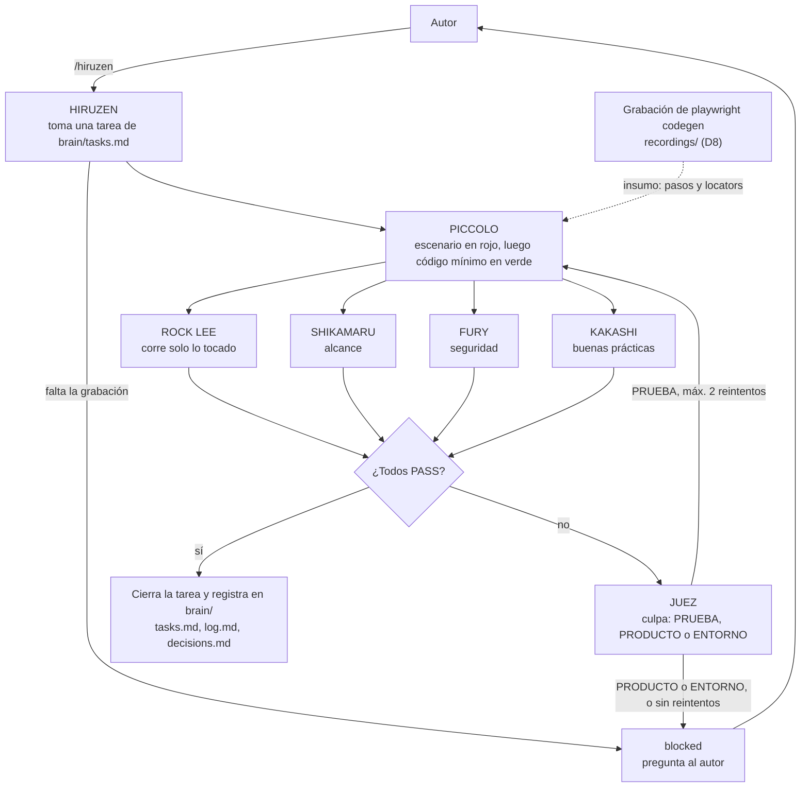

# Cómo construí esta suite con IA

Cómo trabajé, no solo qué entregué: el flujo que diseñé para usar IA, sus reglas y seis problemas reales. Todo se puede rastrear en [`brain/log.md`](../brain/log.md) (bitácora), [`brain/decisions.md`](../brain/decisions.md) (decisiones D-n con su porqué), [`brain/tasks.md`](../brain/tasks.md) (tareas y criterios) y [`.claude/`](../.claude/) (agentes, orquestador y hook).

## Qué es este flujo

No pido código y lo pego: es un flujo en Claude Code con tres piezas.

- **Roles separados.** Un agente implementa y otros cuatro validan: quien escribe el código no es quien lo aprueba. SHIKAMARU, FURY y KAKASHI solo pueden leer archivos y ver `git diff`/`git status`. ROCK LEE tiene acceso a la terminal porque corre las pruebas; que no modifique archivos lo fijan sus instrucciones, no sus herramientas. JUEZ, con las mismas limitaciones de lectura, dictamina por qué falló algo antes de permitir un reintento; diagnostica, nunca arregla.
- **Memoria en `brain/`.** Criterios de aceptación, decisiones con su porqué y cada intento, FAIL y dictamen quedan escritos. Una sesión nueva no depende de lo que la IA "recuerde": lee el estado antes de empezar.
- **Verificación del orquestador.** El orquestador (HIRUZEN, el agente que coordina una tarea de principio a fin) no les cree a los demás agentes: antes de mostrarme algo, contrasta lo que afirman con el diff y la salida real de las pruebas.

Yo defino qué se construye, decido y apruebo cualquier publicación.

## El flujo

`blocked` es el estado de una tarea que no puede seguir sin mi intervención. Los flujos de interfaz parten de una grabación mía con `playwright codegen`. La grabación es insumo, no código: PICCOLO toma de ahí los pasos y los locators (la forma de ubicar un elemento en la página, como "el botón llamado Add to cart") y los convierte a Page Objects (clases que representan una página y exponen sus acciones) y steps (funciones que traducen cada frase Gherkin a código), según [D8](../brain/decisions.md).

## Agentes y modelo

| Agente | Rol | Modelo |
|---|---|---|
| HIRUZEN (`/hiruzen`) | Orquesta una tarea de principio a fin | El de la sesión principal |
| PICCOLO | Implementa con test primero | sonnet (opus si la tarea toca muchos archivos) |
| ROCK LEE | Corre las pruebas y reporta | haiku |
| SHIKAMARU | Vigila que no haya nada fuera del criterio | sonnet |
| FURY | Revisa seguridad y fugas de secretos | opus |
| KAKASHI | Revisa POM, BDD, locators y esperas | sonnet |
| JUEZ | Diagnostica fallos antes de reintentar | opus |

Quien solo ejecuta usa el modelo más liviano; quien evalúa riesgo o diagnostica, el más capaz ([D10](../brain/decisions.md)).

## Reglas que impuse y por qué

Viven en [`CLAUDE.md`](../CLAUDE.md).

- **Test primero.** El escenario se escribe y se ve fallar antes del código: un test que nunca se vio fallar puede no estar probando nada. No siempre se cumplió: en T3 la bitácora registra que PICCOLO no evidenció el escenario en rojo antes del código (`brain/log.md:59`). En T9 y T11 el log ya anota el rojo concreto.
- **Nunca reportar en verde lo que no se corrió.** En T4 los cuatro validadores dieron PASS, pero el orquestador, con navegador visible, encontró que el navegador tomaba el idioma de Windows y los locators por texto fallaban. Se fijó el inglés ([D18](../brain/decisions.md)).
- **Alcance mínimo.** Nada que la tarea no use; SHIKAMARU lo hace cumplir. Lo útil pero fuera del criterio se anota para otra tarea.
- **Separar lo confirmado de lo supuesto.** Ver caso 6.
- **Validar solo lo tocado.** Se corre el escenario de la tarea, no la suite completa ([D28](../brain/decisions.md)).
- **Hook de seguridad.** Un hook (un script que Claude Code ejecuta antes de cada comando) revisa el comando completo, porque las reglas de permisos no bastaron (caso 3, [D25](../brain/decisions.md)).

## En cifras

Contadas en `brain/tasks.md` y `brain/log.md` al cierre de T5, la última tarea cerrada (cubre T1–T17).

- **16 tareas cerradas** (T1–T5 y T7–T17; T6 sigue pendiente).
- **8 reintentos** en total.
- **23 veces un validador marcó FAIL** (22 en tareas y 1 en la revisión del hook de seguridad); solo 3 tareas pasaron a la primera. Muchos eran de calidad o alcance, no tests rotos.
- **10 dictámenes de JUEZ** y **3 hallazgos de QA** del sitio documentados en el [README](../README.md#hallazgos-de-qa-en-toolshop).

## Bitácora de problemas

### 1. Toolshop usa el método HTTP `QUERY`, no `GET`

- **Problema.** El texto de búsqueda aparece antes de que la lista se filtre; verificar en ese momento leía la lista vieja.
- **Cómo se detectó.** KAKASHI marcó FAIL en T2; JUEZ mostró que la prueba podía pasar en falso sobre la lista vieja (`brain/log.md:52`).
- **Qué se decidió.** Esperar la respuesta de la API en vez de una señal visual ([D17](../brain/decisions.md)). Más adelante (T3 y T10) apareció el detalle: el listado y la búsqueda usan el método `QUERY`.
- **Qué cambió.** Las esperas filtran por método y ruta; un filtro por `GET` nunca habría coincidido. Lección: mirar la red antes de escribir la espera.

### 2. La precarga del perfil borraba la dirección escrita

- **Problema.** Con usuario registrado, Toolshop vuelca el perfil en el formulario de dirección y borra lo que la prueba ya escribió.
- **Cómo se detectó.** PICCOLO, en T9. Esperar la API no servía: salen varias peticiones iguales al perfil.
- **Qué se decidió.** Excepción a la regla: esperar el efecto (la calle con valor) antes de escribir. KAKASHI lo objetó; JUEZ confirmó que la espera por API ya había fallado y no hubo reintento (`brain/log.md:107`).
- **Qué cambió.** Esperas según el tipo de acceso, afinadas en T10 con una sonda de red ([D23](../brain/decisions.md)). Lección: con peticiones repetidas, el efecto observable es más fiable.

### 3. `gh repo create --push` saltó una regla de `deny`

- **Problema.** Al crear el repositorio público (lo pedí yo), el push pasó aunque la configuración prohibía `git push`.
- **Cómo se detectó.** Al revisar lo ocurrido: las reglas de permisos solo comparan el inicio del comando (`brain/log.md:126`).
- **Qué se decidió.** Pedí que publicar siempre requiera mi aprobación y una barrera que no dependa del prefijo ([D25](../brain/decisions.md)).
- **Qué cambió.** Publicar pide aprobación y un hook lee cada comando completo: bloquea push forzado, reescribir historia, leer `.env` o commitear archivos sensibles. FURY lo revisó en dos rondas. Frena errores, no ofuscación deliberada.

### 4. T14: implementé bien algo que no se había pedido

- **Problema.** Pedí reducir el ruido de ventanas al correr con navegador visible. La tarea se escribió como "una sola ventana para toda la corrida" y se implementó así ([D27](../brain/decisions.md)).
- **Cómo se detectó.** Ningún validador lo cuestionó: el código cumplía el criterio escrito. Después aclaré que lo que quería era un navegador por prueba, en secuencia (`brain/log.md:147`).
- **Qué se decidió.** Revertir y atacar la causa real: el ruido venía de correr muchas filas, no de abrir una ventana por prueba ([D28](../brain/decisions.md)).
- **Qué cambió.** Dos reglas nuevas: validar solo el escenario tocado y confirmar con el usuario el comportamiento esperado antes de escribir el criterio. Lección: los validadores verifican el criterio escrito, no la intención.

### 5. La captura en fallos no funcionaba con pytest-bdd

- **Problema.** T5 pedía guardar una captura cuando un escenario falla. Solo se había probado con un test simple.
- **Cómo se detectó.** ROCK LEE forzó un fallo en un escenario real: no hubo captura.
- **Qué se decidió.** JUEZ encontró la causa raíz: el hook de pytest que toma la captura no encontraba la página del navegador, porque pytest-bdd la pide de forma dinámica (`brain/log.md:177`, [D29](../brain/decisions.md)).
- **Qué cambió.** La página se guarda donde el hook la encuentra; verificado con un fallo forzado, sin contraseñas en el reporte. Lección: probar el soporte en el contexto real.

### 6. Un fallo forzado bloqueó la cuenta demo

- **Problema.** Para provocar un fallo, la validación de T5 usó una contraseña incorrecta en la cuenta demo compartida. El sitio la bloqueó (`423 Locked`).
- **Cómo se detectó.** ROCK LEE recibió el 423 en una fila sin forzar nada. La causa quedó como "probable" hasta que la captura de T5 mostró el mensaje del sitio (`brain/log.md:185`).
- **Qué se decidió.** ENTORNO: T5 quedó `blocked` y no se reintentó el login para no alargar el bloqueo. Más tarde expiró y la fila pasó.
- **Qué cambió.** Regla nueva en `CLAUDE.md`: nunca forzar fallos con credenciales incorrectas de una cuenta compartida. De paso, probó T5 en un fallo real.

## Qué haría distinto y próximos pasos

- Pendiente: el filtro por texto de fila se rompería con un producto cuyo nombre contenga `login` o `confirmacion` (D24).
- Pendiente: una ventana que se abría y cerraba varias veces, que vi y no se ha reproducido (D28).

Próximas fases, según [`brain/tasks.md`](../brain/tasks.md):

1. **GitHub Actions:** CI y reporte como artefacto, revisando que no publique capturas sensibles.
2. **Supabase:** historial de corridas.
3. **Next.js:** dashboard para lanzar corridas y ver resultados.
4. **Docker:** imagen reproducible.
